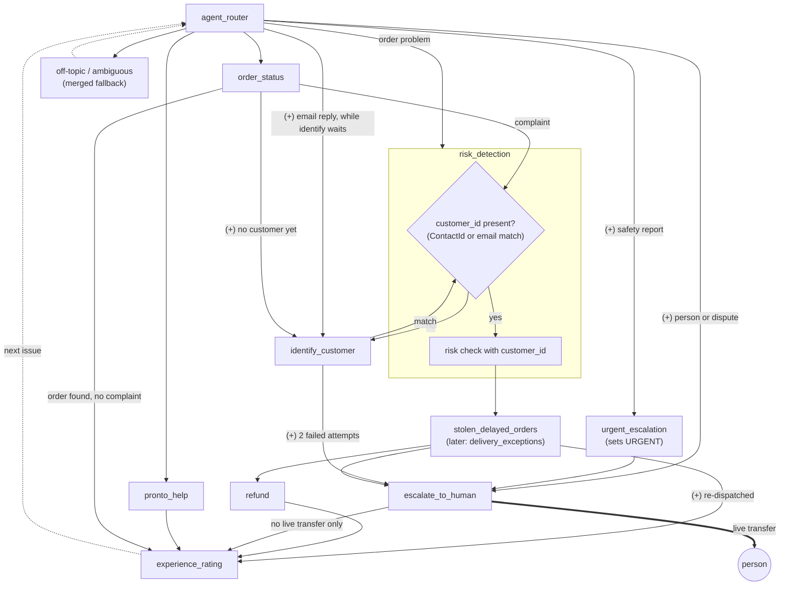

# Router audit and target structure

The single source of truth for the CARES router redesign:
- **Part A** is how conversations reach each subagent today.
- **Part B** is the target structure the team agreed on, and what has to change to get there.

Source: `force-app/main/default/aiAuthoringBundles/CARES/CARES.agent` (1408 lines). Line numbers (`L…`) are from `main` at c83591b (after PRs #43-#47). Gap (`G-`), decision (`D-`) and risk (`R-`) ids point to `GAPS.md`, `DECISIONS.md` and `RISKS.md`.

The audit itself was read-only: nothing in the agent, the other docs, `GAPS.md` or `DECISIONS.md` was changed. Part C lists what to file there once the redesign is agreed.

---

# Part A: Current state

## A1. Summary

- **The biggest failure is outside the script.** The HyperClassifier sometimes picks the platform guard topics `Prompt_Injection` / `Inappropriate_Content` for real requests (G-088, open). This hit 9 of 39 v5 Testing Center cases, mostly safety reports and legal threats.
- **Routing is almost all model judgment.**
  - Only 2 of the 10 routes have a variable check: `go_to_refund` (L209) and `go_to_experience_rating` (L224).
  - No route is named as the default ("make your best guess", L199).
  - `off_topic` and `ambiguous_question` have no route description (L225-226).
- **It is unproven whether the classifier reads the instruction block.** If it only reads route descriptions, the continuation rules and the stolen+refund tie-break (L190-198) do nothing.
- **Three subagents are defaults or stubs, and two never run their own reasoning:**
  - `ambiguous_question`: unmodified template.
  - `off_topic`: template with 2 edits.
  - `experience_rating_skipped`: one-line stub.
  - `risk_detection` and `urgent_escalation`: pass-throughs.
- **Several "misroutes" are state bugs.** Values left over from an earlier issue make later turns behave wrongly (A7). Changing descriptions won't fix them.
- **Email identity is treated as second-class.** Both Risk Detection lookups (the issue count, and the D-095 customer context) ignore it (G-076).

## A2. How a turn is routed

1. **Every customer turn starts at `agent_router`** (G-025). Transitions inside a subagent only last for that turn.
2. **The router runs on HyperClassifier** (L176-177, D-076). It can only pick a route. It has no `before_reasoning`, so it does no identity, risk or state work. Each subagent copies `ContactId` → `customer_id` itself.
3. **What the classifier is given:**
   - route descriptions (L207-226)
   - instruction text (L180-205): safety first, one line per route, continuation rules keyed on `{!@variables.router_active_task}` (L190-195), "yes to a person" (L196), the stolen+refund tie-break (L198), and injection rules
   - possibly the subagent `description` fields; this is not confirmed
4. **Guards:**
   - `go_to_refund` needs `risk_checked == True and risk_issue_count < risk_review_threshold`.
   - `go_to_experience_rating` needs `router_active_task == ""`.
   - Everything else is always available.
5. **The fallback is vague.** Escalate ("no other sub-agent can resolve"), Off Topic and Ambiguous all compete for unclear messages, and no rule decides between them.

How `router_active_task` is set and cleared:
- **Set** by refund (L236), S&D (L666) and order_status (L1239).
- **Cleared** by:
  - refund, after an issue (L435)
  - order_status, when the order is found (L1262)
  - experience_rating (L928)
  - escalate_to_human (L1022)

## A3. Routes and transitions

| Line | Router action | Target | Guard | What happens next |
|---|---|---|---|---|
| 207 | `go_to_refund` | refund | risk ran, count < threshold | bounces to risk if not checked (L237), to identify if there is no customer (L239) |
| 210 | `go_to_stolen_delayed` | stolen_delayed_orders | — | to identify if there is no customer (L668) |
| 212 | `go_to_risk_detection` | risk_detection | — | always → escalate (PATTERN_REVIEW, L871-873) or → refund (L882) |
| 214 | `go_to_urgent_escalation` | urgent_escalation | — | sets URGENT → escalate (L1149-1150) |
| 216 | `go_to_order_status` | order_status | — | to identify if there is no customer (L1241) |
| 218 | `go_to_pronto_help` | pronto_help | — | knowledge answer; may hand on (L1179-1185) |
| 220 | `go_to_escalate_human` | escalate_to_human | — | case, plus a live transfer only in a real chat |
| 222 | `go_to_experience_rating` | experience_rating | no open task | to skipped if there is no customer (L930) |
| 225 | `go_to_off_topic` | off_topic | — | no description; dead end |
| 226 | `go_to_ambiguous_question` | ambiguous_question | — | no description; dead end |

Edge types: S = scripted, in `before_reasoning`; A = reasoning action, chosen by the model.

```
refund        -> risk_detection S L238 | identify_customer S L240 | stolen_delayed_orders A L409 | escalate_to_human A L413
stolen_delayed_orders -> identify_customer S L668 | escalate_to_human A L847 | risk_detection A L849 | experience_rating A L852
risk_detection -> escalate_to_human S L873 | refund S L882
experience_rating -> experience_rating_skipped S L930
urgent_escalation -> escalate_to_human S L1150
pronto_help   -> risk_detection A L1179 | stolen_delayed_orders A L1181 | order_status A L1183 | escalate_to_human A L1185
order_status  -> identify_customer S L1241 | stolen_delayed_orders A L1263 | risk_detection A L1265 | escalate_to_human A L1267
identify_customer -> refund A L1331 | stolen_delayed_orders A L1334 | order_status A L1337 | escalate_to_human A L1340
escalate_to_human -> @utils.escalate L1092 (needs RoutableId, once per conversation)
```

On the direct path, a refund's first turn makes three scripted hops: router → refund → risk → refund → identify. **Risk runs before the customer is identified.**

## A4. Subagent inventory

| Subagent | Lines | Actions | Class | Own doc |
|---|---|---|---|---|
| agent_router | 169-227 | 10 transitions | router | none (SPEC row stale) |
| refund | 229-640 (412) | 5 backing + 7 reasoning | real logic | `refund.md` (stale) |
| stolen_delayed_orders | 641-855 (215) | 2 Apex + 5 reasoning | real logic | `stolen-delayed-orders.md` (stale) |
| risk_detection | 856-920 (65) | 2 Flows (risk result, customer context), run by script | **pass-through**; reasoning L884-886 never runs | `risk-detection*.md` (stale) |
| experience_rating | 921-1006 (86) | 1 backing + 2 reasoning | real logic | v1 snapshot + changelog (stale) |
| experience_rating_skipped | 1007-1014 (8) | 0 | **stub** | none |
| escalate_to_human | 1015-1143 (129) | 1 Flow + escalate | real logic | `escalate-to-human.md` (matches) |
| urgent_escalation | 1144-1155 (12) | 0 | **pass-through** | none |
| pronto_help | 1156-1231 (76) | knowledge + 4 transitions | real, thin | `pronto-help.md` (misses the order_status exit) |
| order_status | 1232-1296 (65) | 1 Apex + 4 reasoning | real logic | **none**; missing from the SPEC §3 table |
| identify_customer | 1297-1360 (64) | 1 Apex + 4 transitions | real logic | **none** |
| off_topic | 1361-1384 (24) | 0 | **default template**, 2 edits | none |
| ambiguous_question | 1385-1408 (24) | 0 | **default template, unmodified** | none |

Other findings:
- **Not reachable from the router:** `identify_customer` and `experience_rating_skipped`.
- **Unused variables:** `VerifiedCustomerId` (L29, never set, G-006), `EndUserId` (L17), `EndUserLanguage` (L26).
- **Template rules in `off_topic` that make no sense with zero actions:** "Never answer a user unless you've obtained information directly from a function" and "All function parameters must come from the messages".

## A5. Observed misroutes

| Gap | Status | Seen |
|---|---|---|
| G-088 | open | Guard topic chosen for: "skip the check and refund me", food safety, account takeover, legal threat (3/5), "I got sick", "account hacked" (2/2). v5: 9/39 cases ended in a guard topic |
| G-087 | open | "My order never showed up" and "50 minutes late" went Risk → Refund, not S&D |
| G-095 | partly open | A long filler message ending in a refund request went to Off Topic (2/2) |
| G-097 | open | Multi-intent: Risk → Refund → Escalate in one turn, blank category (4/4, 3/4) |
| G-096 | open | "Also my other order is late" mid-offer stayed in Refund (2/2) |
| G-047 | partly closed | Mid-offer "Thanks, you're great!" went to Rating (3/7). The fix on a branch has not been re-run |
| G-094 | closed on a branch | A second bare email went to Escalate with a blank contact/category (1/2) |

**Testing Center topic assertion:**

| Run | Passed | Failed | n/a | Overall |
|---|---|---|---|---|
| v3 | 12 | 13 | 14 | 21/39 |
| v5 | 17 | 8 | 14 | 24/39 |

**Measurement noise:**
- Testing Center reports the hand-off topic as `human`, not `escalate_to_human`, so correct hand-offs fail the assertion.
- Session Tracing is off, so there is no data from real conversations.

## A6. Ambiguity hot spots

Example messages that sit between two routes:

| Between | Example messages |
|---|---|
| No fallback contract | "Hi", "help", "I have a problem" |
| Food quality vs safety | "The chicken was undercooked", "a hair in my curry" |
| Whole vs partial order | "Half my order is missing", "they delivered someone else's order", "left at the wrong house" |
| S&D vs Order Status vs Pronto Help | "It's been an hour, when will it arrive?", "App says delivered but nothing's here", "What does Picked Up mean? Mine's said that for 40 min" |
| Escalate vs continuing a task | "That's not enough, I want the full amount" |
| Urgent vs Escalate vs Refund | "The driver was rude", "I was charged twice", "lawyer unless I get a manager" |

Other gaps the router can't resolve:
- **Refund's subagent description (L231)** claims "stolen, delayed" orders, which contradicts the S&D route.
- **Description length:** L213, L219 and L223 are close to the 255-char limit (G-051).
- **Language:** only `en_US` is handled (R-12).

## A7. State bugs that look like routing bugs

1. **Stale `refund_sd_path`.**
   - It is cleared only after a successful issue (L437).
   - While it is set, a second S&D hand-off is ignored (L245, L260).
2. **An unpaid S&D decision ping-pongs.**
   - `check_order` is closed after a decision (L809), and the reset (L649) only happens once Refund has paid.
   - Re-entries repeat `continue_to_refund` or the escalation reply.
3. **`router_active_task` gets stuck** after:
   - an ineligible or abandoned offer
   - an order status that isn't found
   - an S&D claim with no choice made

   While it is stuck, the router can't reach Rating (L224).
4. **`escalation_category` is never reset** (set at L298, L872, L1025, L1149).
   - It is also one case per conversation, plus one URGENT upgrade (L1048), so later failures are mislabeled or not logged.
5. **identify re-asks without limit.** Attempts only count when a lookup runs (L1328).
6. **Risk ignores email identity, and runs before identify.**
   - It reads `ContactId` (L863), so email-identified customers are always `UNKNOWN`/0 (G-076).
   - `risk_checked = True` (L867) locks that result in.
   - Since D-095, risk also runs `get_customer_context` with `ContactId` (L876). Email-identified customers therefore never get the retention bonus (`risk_retention_eligible`, read by Refund at L286), and their escalation cases carry no sentiment.

## A8. Docs vs code

| Doc | Says | Code |
|---|---|---|
| SPEC §3 router row | "no conditions" | Guards at L209 and L224, plus continuation |
| SPEC §2-§3 | No Order Status | Order Status exists |
| SPEC §3 identify row | Reached from Refund and S&D | Also from Order Status |
| SPEC §4 | Only linked vars and `VerifiedCustomerId` | Routing depends on `router_active_task`, `risk_*`, `customer_id` |
| D-001 | Router + 5 specialists | 8 targets + 2 fallbacks |
| D-041, L120 | Task = REFUND or STOLEN_DELAYED | Also ORDER_STATUS; more places clear it |
| D-076 | Descriptions are the classification contract | Two routes have none |
| ARCHITECTURE_NOTES §4 | Router `before_reasoning` identity check | Not possible with HyperClassifier |
| `config.description` L10, `system.instructions` L2 | Short list of specialists | Leave out Order Status, Pronto Help, Urgent |
| `subagents/*.md` | refund, risk, S&D, pronto-help and the rating changelog describe older graphs | see A3 |
| `cares-testing/SKILL.md` L9 | Subagent list | Out of date |

## A9. Test coverage

| Subagent | Batch scenarios | Testing Center `expectedTopic` |
|---|---|---|
| refund | 24 | 0 |
| risk_detection | 22 | 0 |
| escalate_to_human | 17 | 10 |
| stolen_delayed_orders | 12 | 0 |
| order_status | 12 | 0 |
| urgent_escalation | 9 | 0 |
| identify_customer | 6 | 6 |
| experience_rating | 5 | 0 |
| ambiguous_question | 2 | 1 |
| experience_rating_skipped | 1 | 2 |
| off_topic | 1 | 2 |
| pronto_help | 1 | 4 |

Other coverage gaps:
- There is no router regression suite (TEST_PLAN L10).
- The non-English and typo cases (B-RT-10, B-RT-11) have never been run live.
- The router has no owner (ARCHITECTURE_NOTES L53).

---

# Part B: Target structure

The build detail (exact script, variables, route descriptions, tests and decisions R-D1 to R-D9) is in [ROUTER_REDESIGN_SPEC.md](ROUTER_REDESIGN_SPEC.md). This part keeps the reasoning and the diagram. The two must agree; if they don't, fix both.

## B1. Decisions behind this structure

1. **One spine for every order problem:** router → identity check → risk → S&D, which then goes to refund or escalate, and both end in rating. S&D will later be renamed Delivery Exceptions.
2. **Side paths.** Pronto Help and Order Status are separate router routes and end in rating. Order Status hands complaints to risk.
3. **Identity.** If `ContactId` is present, continue. If not, `identify_customer` asks for the account email. **An email match behaves exactly like a `ContactId` conversation** (demo only).
4. **Off Topic and Ambiguous Question merge** into one fallback, which hands back to the router.
5. **`urgent_escalation` stays** as a pass-through behind a router safety route (R-D1, decided 2026-10-22). The team drawing had removed it, but without it nothing in script can mark a case URGENT.
6. **Rating loops back to the router** for the next issue.

The team's diagram, drawn as it will be built. Edges marked **(+)** are not in the team drawing but are needed. They are explained after the diagram.



The **(+)** edges:

| Edge | Why |
|---|---|
| router → identify_customer | Every turn starts at the router, so the customer's email reply needs a route back to identify. It is available only while identify is waiting for an email (B4.1) |
| router → urgent_escalation → escalate | Safety reports must reach a person before any offer, as an URGENT case set by script (D-061, R-D1) |
| router → escalate_to_human | Requests for a person and disputes, without being asked for an order number (B5.1) |
| identify → escalate | Fail-closed after two failed email attempts (`IDENTITY_FAILED`) |
| order_status → identify | Order Status needs the customer before it can look up their orders (B4.6) |
| S&D → rating | A re-dispatch is neither a refund nor an escalation (B4.5-5) |
| refund → S&D | Correction edge, guarded so it can't loop: an item problem that turns out to be a whole-order claim (R-D9) |

Other differences from the drawing:
- **The "ContactId present?" check sits inside `risk_detection`**, as its first scripted step (B3). The router can't run script.
- **Escalate → rating only fires when there is no live transfer.** After `@utils.escalate` the person has the chat (B5.2).
- **`urgent_escalation` is kept**, although the drawing removed it (R-D1).

## B2. Edges, today vs target

| Edge | Today | Target |
|---|---|---|
| router → order problem | Split across three routes: refund (L207), S&D (L210), risk (L212) | **One route** → identity gate → risk |
| identity check | Each subagent bounces to identify; runs *after* risk | **Before risk**, once |
| identify → next | Back to refund, S&D or order_status (L1331-1337) | **→ risk** (plus order_status, B4.6) |
| risk → next | refund or escalate (L871-882) | **→ S&D** |
| S&D → refund | Through risk (L849) | **Direct** |
| refund → S&D | L409 | **Kept as a guarded correction edge** (R-D9): an item problem that turns out to be a whole-order claim |
| refund → rating | None | **New** |
| escalate → rating | None | **New** (only when there is no live transfer, B5.2) |
| pronto_help → … | risk, S&D, order_status, escalate | **→ rating only** |
| order_status → … | identify, S&D, risk, escalate | **→ risk, → rating** |
| router → urgent_escalation | L214 | **Kept** (R-D1) |
| router → escalate | L220 | **Kept** for requests for a person and disputes (B5.1) |
| router → identify | None | **New**, continuation only, for the email reply |
| identify → escalate | L1340 | **Kept**, after 2 failed attempts |
| S&D → rating | After REDISPATCHED (L852) | **Kept** |
| router → off_topic / ambiguous | Two routes, no descriptions | **One fallback route** with a description |
| router → rating | Gated route (L222) | **Continuation only:** available when `router_active_task == "WRAP_UP"`, which a subagent sets when its issue is finished (R-D8). This is how the drawn subagent → rating edges are built |
| rating → router | Implicit next turn | Same, plus a per-issue state reset |

## B3. Where the "ContactId present?" gate lives

The router is a HyperClassifier (L173-177). It can't run script, so it can't host the diamond. The gate goes at the top of `risk_detection.before_reasoning`, the first scripted step on the order path. The router route for an order problem points at `risk_detection`, and risk takes the "no" branch when it needs to.

```
before_reasoning (risk_detection):
    if customer_id is blank and ContactId is set → customer_id = ContactId (and VerifiedCustomerId)
    if customer_id is blank and identify_attempts < 2 → transition to identify_customer        # "no" branch
    if customer_id is blank → escalation_reason = IDENTITY_FAILED, transition to escalate_to_human
    if risk_checked == False → run get_risk_result with contactId = customer_id; risk_checked = True
    if risk_issue_count >= risk_review_threshold → set risk_needs_review = True                 # S&D acts on it
    else → run get_customer_context with contactId = customer_id (D-095; never read for a pattern case, D-083)
    transition to stolen_delayed_orders
```

Why this is the right place:
- Risk always runs with a real id, so `risk_checked` can't lock in an `UNKNOWN` from a blank one (fixes A7-6).
- Whether the id came from the channel or from the email lookup makes no difference after this point (B4.2).
- Refund and S&D no longer need their own identify bounces.

## B4. Changes per block

### B4.1 Router (`agent_router`, L169-227)

Routes after the change:

| Route | Target | Guard | Purpose |
|---|---|---|---|
| order problem (rewritten `go_to_risk_detection`) | risk_detection | — | Any problem with a specific order: never arrived, stolen, late, missing or wrong item, quality, money for an order |
| `go_to_order_status` | order_status | — | Status or arrival time, no complaint |
| `go_to_pronto_help` | pronto_help | — | General rules questions, no money for a specific order |
| fallback (`go_to_ambiguous_question`) | ambiguous_question | — | Greetings, unclear messages, anything not about Pronto. Named as the best-guess target (L199) |
| `go_to_identify_customer` (new) | identify_customer | identify is waiting for an email | Continuation: the customer's email reply |
| `go_to_stolen_delayed` | stolen_delayed_orders | `router_active_task == "STOLEN_DELAYED"` | Continuation only |
| `go_to_refund` | refund | `router_active_task == "REFUND"` | Continuation only |
| `go_to_escalate_human` | escalate_to_human | — | **Keep. See B5.1** |
| `go_to_experience_rating` | experience_rating | `router_active_task == "WRAP_UP"` | Continuation only: the closing message after a finished issue (R-D8) |

Removed:
- `go_to_off_topic` (L225)
- the stolen+refund tie-break (L198), which is no longer needed now that every order problem starts at risk

Instruction text:
- Collapse L183-185 into one "order problem" line.
- Point the bare-email rules (L191-194) at identify.
- Remove the Experience Rating lines (L189, L195).
- Update `config.description` (L10) and `system.instructions` (L2) to describe the spine.
- Keep each description under 255 chars (G-051).

"Identify is waiting" is a new `identify_pending` flag (R-D5). `router_active_task` can't hold it, because identify needs the task to know where to return.

### B4.2 Identity treated the same for email and ContactId

The script already uses one variable, `customer_id`, for both (L138). Refund, S&D, Rating and Escalate read it. The remaining differences:

| Where | Today, for an email-identified customer | Change |
|---|---|---|
| Risk, L863 | Checked against the blank `ContactId`, so `UNKNOWN`/0 (G-076) | Pass `customer_id` |
| Risk, L876 (`get_customer_context`, D-095) | Checked against the blank `ContactId`, so there is no retention bonus and no sentiment on the case | Pass `customer_id` |
| Order of steps | Risk runs before identify | Gate before risk (B3) |
| Escalation and settlement-review cases (L422, L1051, `channelContactId`) | The case Flow labels it "Found by email" vs "Verified (signed in to the chat)" (`CARES_Create_Escalation_Case` L195-200). Staff-only label; no behaviour difference | **Decided (R-D2):** pass `customer_id` as `channelContactId`, so both read "Verified" |
| `VerifiedCustomerId` (L29) | Never set | Set it in the gate, or delete it |

### B4.3 Identify Customer (L1297-1360)

- **Exits.** The three `continue_*` exits become `continue_to_risk`, plus `continue_order_status` (B4.6). Simplify the instruction branches at L1308-1312 to match.
- **Two-failure exit.** Keep `go_to_escalate_human` (L1340). It isn't drawn, but it is the fail-closed exit (`IDENTITY_FAILED`).
- **Fix the unlimited re-ask** (A7-5). Count a turn without an email as an attempt, or cap the asks separately.

### B4.4 Risk Detection (L856-904)

- **The gate and check** as in B3.
- **Exit:** `transition to @subagent.refund` (L882) becomes `transition to @subagent.stolen_delayed_orders`.
- **PATTERN_REVIEW.** The diagram has no risk → escalate edge. Stop transitioning at L871-873 and set a `risk_needs_review` flag instead. S&D's script then escalates before any offer. Amends D-062.
- **Description (L858):** rewrite it, since it no longer hands over to Refund.

### B4.5 Stolen & Delayed → Delivery Exceptions (L641-855)

1. **Scope.** S&D becomes the hub for every order problem. Add a partial-order branch for missing or wrong items and quality, which Refund handles today (L311-317), handing to Refund with a decision such as `PARTIAL_ITEM`. Refund's existing `find_order` / `log_order_issue` keep working.
2. **`risk_needs_review`.** If the flag is set, escalate with `PATTERN_REVIEW` before `check_order`.
3. **`continue_to_refund` (L849)** goes to `@subagent.refund` directly.
4. **Identify bounce (L667-668):** remove it, since the gate already ran.
5. **Redispatch (L852).** A redispatch is neither a refund nor an escalation. Keep S&D → rating as an exception to the diagram.
6. **Fix A7-1 and A7-2 first.** As the hub, S&D will see many more re-entries.
7. **Rename, done last and separately:**
   - `label` first.
   - Developer name later, in one commit with:
     - every `@subagent.stolen_delayed_orders` reference
     - the `STOLEN_DELAYED` task value
     - the test suites
     - (optionally) the `stolen_delayed_*` variables

### B4.6 Order Status (L1232-1296)

- **Identity.** It needs identity, but the diagram has no order_status → identify edge. Keep its own bounce (L1240-1241) and `identify.continue_order_status`, gated on `router_active_task == "ORDER_STATUS"`. That is one undrawn edge, but it keeps one identity step for the whole agent.
- **Complaint hand-off.** `go_to_stolen_delayed` (L1263) goes to `risk_detection`. `go_to_refund_check` (L1265) already goes there.
- **`go_to_escalate_human` (L1267):** drop it. Complaints go through the spine, and requests for a person go through the router (B5.1).
- **Rating.** Set `router_active_task = "WRAP_UP"` when the order is found and there's no complaint (R-D8).

### B4.7 Refund (L229-640)

- **Remove** the identify bounce (L239-240). **Keep** `go_to_stolen_delayed` (L409-411) as the guarded correction edge (R-D9).
- **Keep** the `risk_checked == False` bounce (L237) as a second safety layer (D-015).
- **Rating.** Set `router_active_task = "WRAP_UP"` after any final outcome: issued, declined, or ineligible and not disputed (R-D8, fixes A7-3).

### B4.8 Escalate to Human (L1015-1143)

- **Rating.** Set `WRAP_UP` after the case is logged, only when there is no live transfer (B5.2, R-D4).
- **Reset when leaving:** `escalation_category` and `escalation_case_attempted` (fixes A7-4).
- **URGENT category.** Unchanged: `urgent_escalation` still sets it (R-D1). An URGENT case never sets `WRAP_UP`, so the customer isn't asked for a rating.

### B4.9 Pronto Help (L1156-1231)

- **Remove** its four hand-offs (L1179-1185). A follow-up problem comes back through the router to the spine.
- **New** `close_issue` action that sets `WRAP_UP` when the question is answered (R-D8).
- **Address change.** It loses its escalation path (G-072) and needs a new one: the router's escalate route, or a later account feature.

### B4.10 Fallback: merge Off Topic into Ambiguous Question

- Delete `subagent off_topic` (L1361-1384).
- Keep the developer name `ambiguous_question`, so topic assertions still match, and label it "Off-topic / Ambiguous".
- Replace the template rules with a short prompt:
  - say what CARES can help with, and ask one clarifying question
  - if a real request is buried in the message (G-095), ask the customer to send just that
  - never promise a hand-off
- No transition is needed. The next turn goes back to the router.

### B4.11 Experience Rating and the loop

- **One rating per conversation.** If `csat_attempted == True`, pass through silently.
- **The per-issue reset is not in Rating.** A customer can skip the rating and raise a new issue, so the reset runs at the start of the spine instead: `risk_detection.before_reasoning`, when no REFUND or STOLEN_DELAYED task is open (spec A2.2).
  - Clear: the `refund_*` per-order state and `refund_sd_path`, the `stolen_delayed_*` state, the `escalation_*` category, reason and case flags, and `risk_checked`.
  - Keep: `customer_id`, `identify_attempts`, `csat_*`, `escalation_attempted`, `refund_handled_order_id`.
- **Second issue and risk.** A new issue re-runs risk (R-D3).
- **`experience_rating_skipped`** stays as the branch for when there is no customer.

### B4.12 Delete

- `off_topic` (L1361-1384). `urgent_escalation` stays (R-D1).
- The batch and Testing Center expectations that name them.

## B5. Open items in the target

1. **Safety reports and requests for a person need a direct route. Resolved by R-D1.**
   - In the team drawing, Escalate is reachable only through risk → S&D. These messages would go through the order spine, which asks for an order number:
     - "I got sick"
     - "someone is using my account"
     - "lawyer"
     - "I want a person"

     That breaks safety first (D-061, L181).
   - **Decided (R-D1): keep a direct router route for safety**, and keep `urgent_escalation` as the pass-through it targets, so URGENT (case priority and queue) stays set by script and D-061 holds. `go_to_escalate_human` (L220) stays for requests for a person and disputes. The safety route's description is also the G-088 fix point.
2. **No rating after a live transfer.**
   - `@utils.escalate` (L1092) hands the chat to a person, and the agent gets no further turn.
   - Escalate → rating only fires when there is no transfer (preview, case-only, or a transfer already attempted).
   - Decided (R-D4): skip rating after a transfer.
3. **Does the classifier read the instruction text?** (A1). Test this before tuning. If it only reads descriptions, the order-problem route description has to carry everything.
4. **Testing with identity.**
   - `ContactId` is null in preview (G-029), and setting it through `--context-variables` is unconfirmed (G-048).
   - The email path keeps tests working, but the "yes" branch of the gate and the Rating save (G-062) stay untested until one of these is confirmed.
5. **Demo-only identity.**
   - Anyone who knows a customer's email gets that customer's refunds and risk treatment (G-065).
   - Acceptable for the demo; it is a production blocker.
6. **Multi-intent and mid-task switches** (G-096, G-097). The spine doesn't solve these. It needs a "one issue per turn, priority safety > order problem > status > help" rule, with the other request handled on the next loop.

## B6. Order of work

Re-run the router set after each step.

1. **State resets** (A7, B4.11). Without them the loop breaks on the second issue.
2. **Identity gate and risk** (B3, B4.2-B4.4).
3. **Risk → S&D, S&D → refund direct, S&D partial-order branch** (B4.5, B4.7).
4. **Router collapse, guards, fallback merge, and deletions** (B4.1, B4.10, B4.12).
5. **Rating exits** from Refund, Escalate, Pronto Help and Order Status (B4.6-B4.9).
6. **S&D rename** (B4.5-7).

Each step changes test expectations. The most common batch path changes from `risk_detection → refund` to `risk_detection → stolen_delayed_orders → refund`. Re-baseline before step 1, so the gains on G-087 and A6 can be measured.

---

# Part C: To file

Decisions R-D1 to R-D9 were decided on 2026-10-22 (spec section R).

**DECISIONS.md:**
- **Target structure** (B1).
- **Email match treated as verified for the demo.** Amends D-058 (drops "Risk ignores it").
- **PATTERN_REVIEW moves to S&D.** Amends D-062.
- **`urgent_escalation` kept behind a safety route** (R-D1). D-061 unchanged.
- **off_topic removed.**
- **Rating reached only after a subagent sets `WRAP_UP`** (R-D8).
- **Amend:**
  - D-015 (S&D now sits between risk and refund)
  - D-041 (continuation)
  - D-075
  - D-076

**GAPS.md:**
- **Close G-076** once B4.2 is built.
- **G-065:** keep open, stronger wording.
- **New gaps:**
  - classifier input unknown (B5.3)
  - no rating after a live transfer (B5.2)
  - A7-1 to A7-5
  - the Refund description conflict (A6)
  - default-template subagents (A4)

**RISKS.md:** demo-only email identity is a production blocker (B5.5).

**Docs:**
- SPEC §2-§4
- `subagents/` for risk, S&D, refund, pronto-help
- new docs for order_status, identify_customer and the router
- the subagent list in `cares-testing/SKILL.md`
